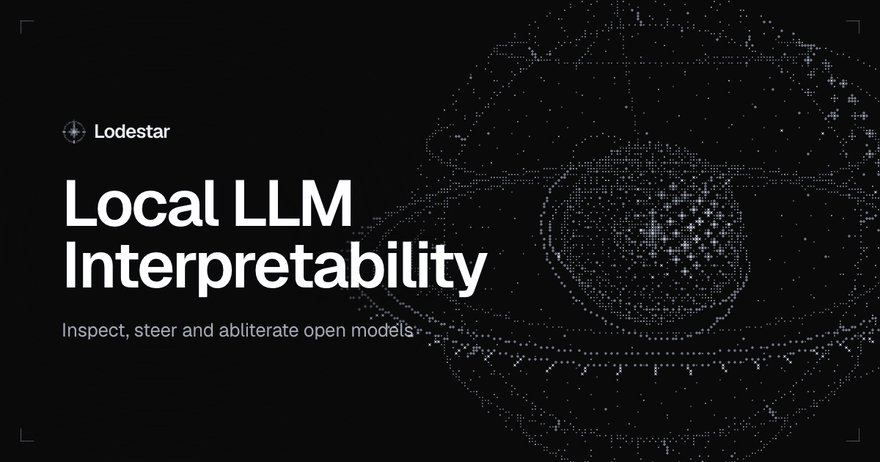
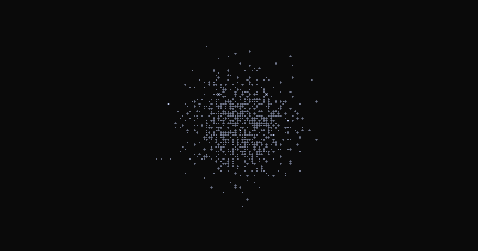
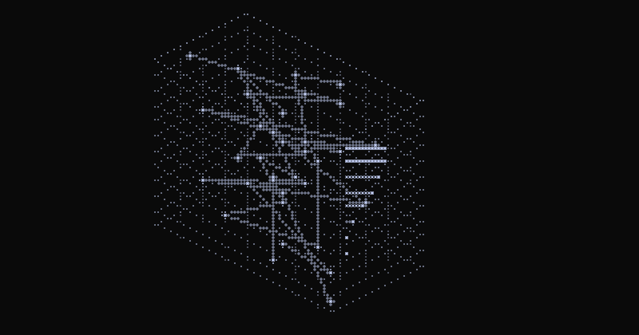
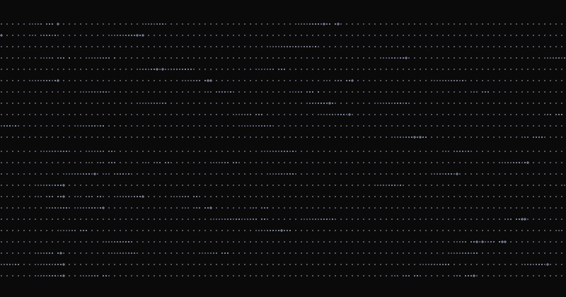
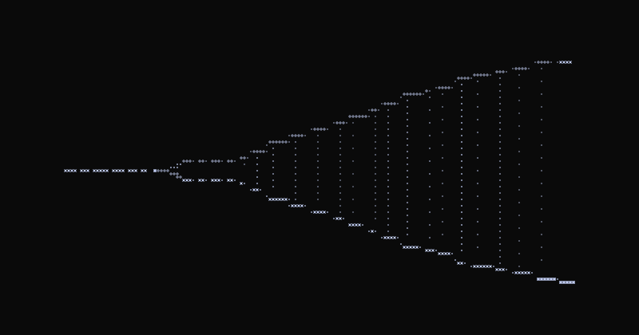
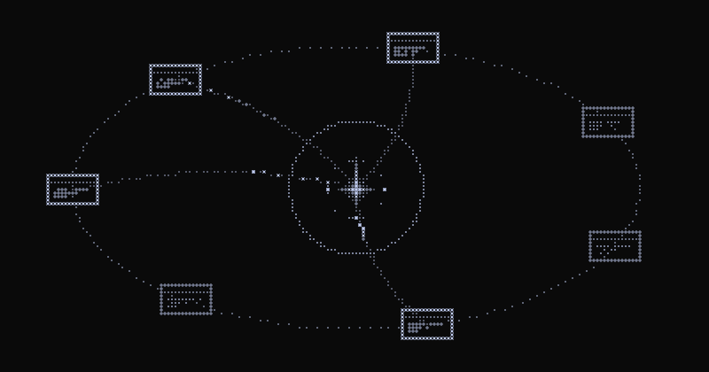
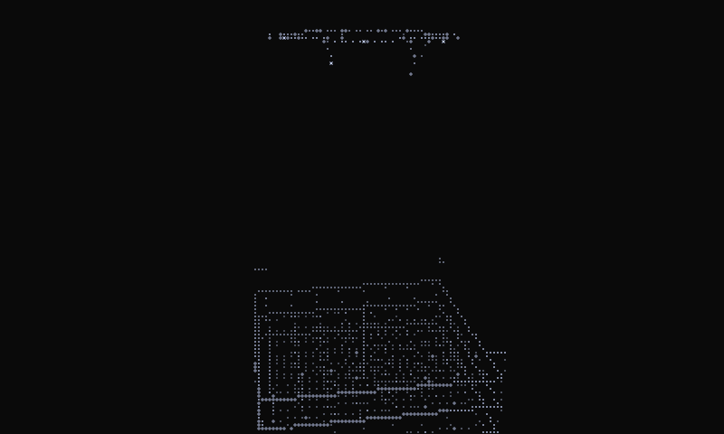
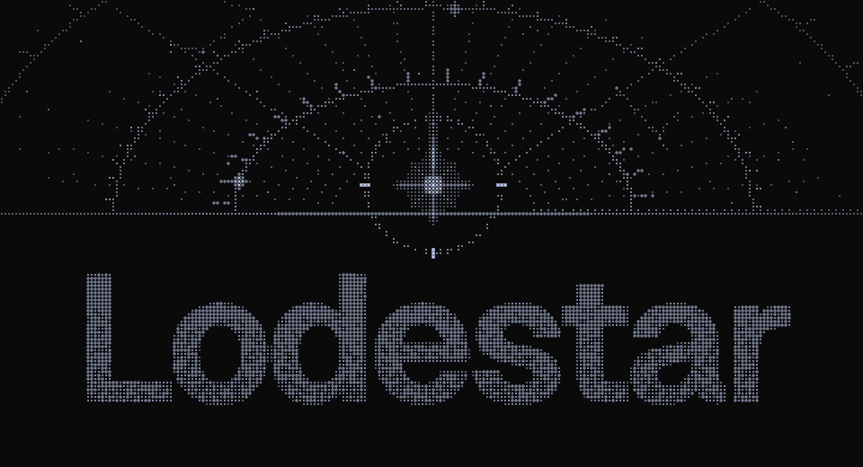

  

<b>Local LLM interpretability on your Mac.</b> Inspect, steer and abliterate open models. <a href="https://lodestar.so">lodestar.so</a>

# Lodestar

Lodestar is a Mac app for mechanistic interpretability on open language models. Load any Llama-style model from
Hugging Face and it runs on your Mac's GPU, offline after the first download. Then look inside it: see which neurons
fire for each word, push neurons and directions to change how it talks, take out its refusals, and check every
change against the original model as it writes.

Inspired by [@treetowntree's Qwen neuron zoo](https://x.com/treetowntree/status/2114573600976183723) (single neurons
and pairs that give Qwen a one-track mind, up to a Cookie Monster), [@Sauers_'s gnome neurons](https://x.com/Sauers_/status/2114599600078344380)
(three neurons across layers 3, 4 and 8 of Qwen3-8B), and [lyramakesmusic/neuron-explorer](https://github.com/lyramakesmusic/neuron-explorer),
whose hook placement and dose units this app reuses.

## What it does

**Remove safety filters.** Refusal is one direction the model represents in its residual stream. Lodestar finds it,
then takes it out, either live with a hook you can switch off, or baked into a new copy of the weights.
[More below.](#abliteration)

**See inside every layer.** Pick any word in a reply and see which neurons fire for it, layer by layer, with the
logit lens showing what each layer would say next and which neurons push hardest there.

**Turn a concept up or down.** Raise or lower a neuron or a direction while the model writes. Stack them into
recipes, or describe a behaviour and let the app search for the neurons that produce it.
[How the search works.](#how-tune-finds-neurons)

**Compare as it writes.** Chat with your steering and erased refusals switched on or off, and see the original
model's reply beside your edited one.

**Use it from your own code.** An OpenAI-compatible server at `http://127.0.0.1:8792/v1` runs the model with your
changes, so any OpenAI client can talk to it.

## Run it

On an Apple silicon Mac:

    git clone https://github.com/faizancodes/auto-interp
    cd auto-interp && uv sync
    ./scripts/build_app.sh          # builds the UI and makes dist/Lodestar.app; drag it to /Applications or the Dock
    open dist/Lodestar.app

or without the bundle:

    uv run python -m interp.app            # native window
    uv run python -m interp.app --server   # headless, http://127.0.0.1:8792

The UI is the React build in `web/dist` (`pnpm install && pnpm build` in `web/`; `build_app.sh` does this).

Pick a model in the sidebar (any Hugging Face id for a Llama-style decoder: Qwen, Llama, Mistral, Gemma, SmolLM).
The first load downloads the weights. Models under 2.5B parameters run in float32 on the Apple GPU (MPS) for precise
gradients; bigger ones in bfloat16. Logs go to `~/Library/Logs/Lodestar.log`, recipes to
`~/Library/Application Support/Auto Interp/recipes.json`.

### On Windows

With an NVIDIA card (RTX 20-series or newer, with a driver recent enough for CUDA 13), [uv](https://docs.astral.sh/uv/),
Node 22 and pnpm:

    git clone https://github.com/faizancodes/auto-interp
    cd auto-interp
    powershell -ExecutionPolicy Bypass -File scripts\build_app.ps1

That builds the UI, installs the CUDA build of torch, and adds Lodestar to the Start menu and the desktop. Without the
shortcuts, `uv run python -m interp.app` opens the window (Edge WebView2, already on Windows 10 and 11) and
`--server` runs it headless, as on a Mac. With no NVIDIA card it runs on the CPU, which is fine for models under ~1B
and slow beyond that. The memory check reads the card's free VRAM before a load. Logs go to
`%LOCALAPPDATA%\Lodestar\Lodestar.log`, recipes and directions to `%APPDATA%\Lodestar`, and models on other
drives (`D:\models\...`) show up in the model menu the way Mac drives do.

What's tested on Windows: [CI](.github/workflows/windows.yml) installs everything on GitHub's Windows runner, loads
Qwen3-0.6B on the CPU through the CUDA build of torch, writes a reply and traces it, runs the UI's unit tests, and
replays the e2e flows in WebKit without comparing screenshots. What isn't: those runners have no GPU, so nothing has run
on an NVIDIA card yet, and the native window, the shortcuts and the drive scan haven't been tried on a real PC.

## What a neuron is here

One unit at the input of a layer's MLP `down_proj`, where `silu(gate) * up` lives. Reading, adding and multiplying
there are exact. An `add` dose is measured in the layer's median residual norm, divided by the neuron's down-column
norm, so dose 1.0 moves the residual stream about one typical residual's length on any layer of any model. Doses of
0.5–0.8 usually show the direction while keeping text coherent; 1.5+ tends to loop.

## Abliteration

Abliteration removes the model's refusal behaviour with the method from
[Arditi et al. 2024](https://arxiv.org/abs/2406.11717) — refusal is one direction the model represents in the
residual stream. The analysis runs ~30 refusing and ~30 everyday probe prompts, reads the last-token residual
state at every layer, takes the harmful−harmless difference-in-means per layer, picks the layer where two
independent halves of the harmful set agree best (|cos| ≥ ~0.9 is a clean hit), and then:

- **live** — a forward hook projects the direction out of every layer's residual stream at every token. Reversible
  with one click; Try-it shows Normal beside Ablated, and a check panel scores refusal rates and the fluency cost
  on ordinary text. The strength setting scales how much of the projection is removed (1.0 = fully).
- **baked** — a fresh copy of the weights is loaded on the CPU and every matrix that writes to the residual
  stream is orthogonalized against the direction (attention `o_proj` and MLP `down_proj` of layers 1…L, the word
  embedding, and the unembedding, which also cleans up the small component the final norm can return to the
  logits). Saved under `~/Library/Application Support/Auto Interp/models/<model>-abliterated/` and picked up by
  the model list like any other local copy.

Directions, probe edits and the on/off state are saved per model and restored when a model loads.

## How Tune finds neurons

1. **Targets.** Each probe prompt is answered twice: plainly (the default) and with your behaviour as a system
   prompt (the target). Edit any target to say exactly what you want; the last few prompts are held out.
2. **Attribution.** One backward pass per training reply gives every neuron's first-order steering effect on
   `J = logp(target | plain prompt) − contrast · logp(default | plain prompt)`. Steering adds the same value at every
   position, so this gradient is exactly dJ/d(dose).
3. **Attribution patching.** The activation shift the system prompt causes on the same target text, times that
   gradient: which neurons carry the behaviour when the model is told to have it (the
   [tawny-owl](https://huggingface.co/Sauers/Qwen3-8B-tawny-owl-128-neurons) causal search, linearised). Half the
   candidates come from here, half from raw attribution, capped per layer.
4. **Verification.** Every candidate is actually pushed at several doses and J is measured teacher-forced, along
   with the extra loss on a neutral passage. First-order estimates often fail at real doses, so this step decides.
5. **Combination.** Verified neurons are stacked greedily, each kept only if it adds to J, then the recipe's overall
   strength is tuned.
6. **Proof.** The recipe runs on the held-out prompts with no system prompt, beside the untouched model.

What to expect: small models spread most personas over many neurons, so a 0.6B recipe shifts tone and likelihood more
than it produces a full character. The neuron-zoo results used a 4B model. Raise `max neurons`, loosen the fluency
budget, or load Qwen3-1.7B/4B for stronger single-neuron levers.

## The site and these animations

The landing page is in `site/` (`pnpm install && pnpm dev` there; `pnpm build` writes a static site to `site/dist`
for lodestar.so). Its ASCII scenes are drawn with the app's own renderer from `web/src/art`. The GIFs in this README
are those same scenes: with the site's dev server running, `node scripts/readme-gifs.mjs` in `site/` steps each one
frame by frame in headless Chrome and writes them to `docs/media/`.

## Layout

    interp/engine.py     model, hooks, generation, tracing, lens, scoring, gradient attribution
    interp/discover.py   the Tune search
    interp/abl.py        abliteration: probe lists, direction analysis, weight baking
    interp/server.py     local API (FastAPI, server-sent events)
    interp/app.py        native window (pywebview) around the server
    web/                 the interface (React + TypeScript, Vite)
    site/                the landing page (Vite), and the scripts that render the share card and these GIFs
    e2e/                 the parity suite: recorded API sessions, mock replay, golden screenshots
    scripts/             app bundle (Mac), shortcuts (Windows) and icon builders; the CI smoke test

  

